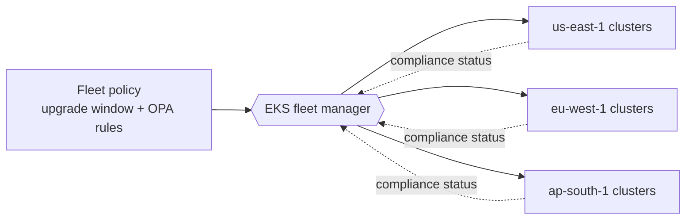
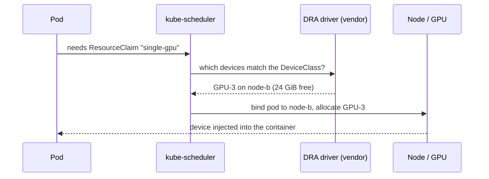
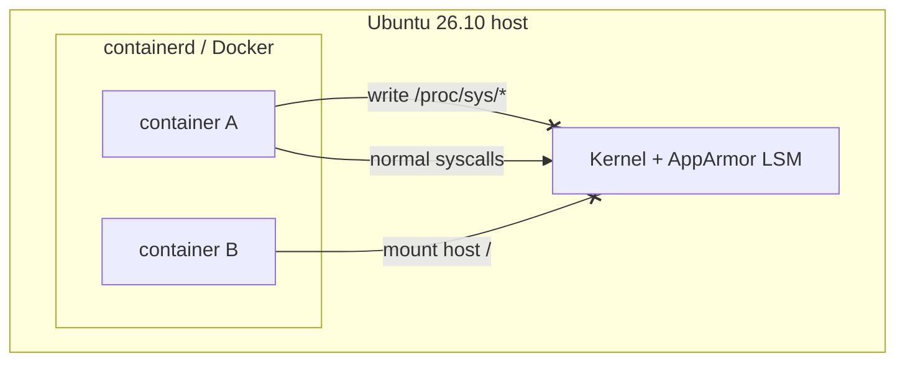
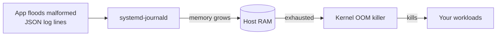
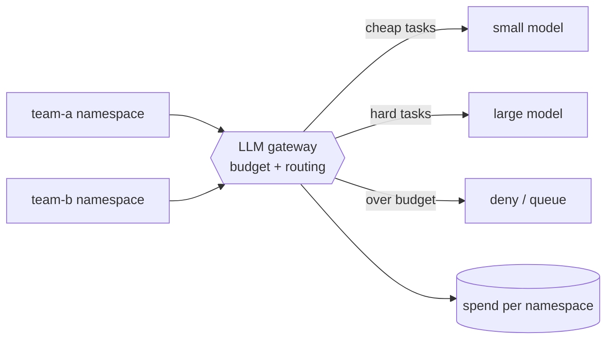
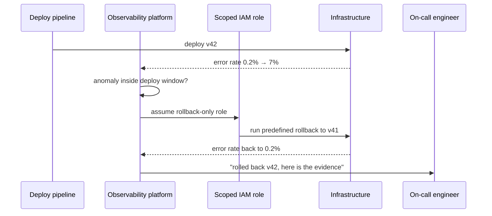

<!--
EDITOR CHECKLIST — remove before publishing (this comment is not rendered).
Add a source link to every item. Known problems in the source digest:
  * OpenTofu: state encryption shipped in OpenTofu 1.7 (2024) and 1.9 went GA in
    Jan 2025, so "1.9 RC introduces state encryption" cannot be right. Find the
    actual release this refers to, or drop the item.
  * Kubernetes: 1.35 was released Dec 2025 (our Feb 16–22 issue covers 1.35
    patches) and DRA reached GA in 1.34. Replace with the release actually in
    feature freeze this week, or drop the item.
  * Linux 7.3: this issue says Ubuntu 26.10 ships 7.3; next week's digest calls
    7.3 "upcoming". Check which is true.
  * Needs a primary source: CVE-2026-80211, EKS cross-region fleet preview,
    CNCF CNAO syllabus, AWS/Microsoft SMR agreements, Datadog/Dynatrace
    closed-loop remediation.
-->


*This week the theme is machines acting on their own: observability tools that roll back a bad deploy before you wake up, distros that sandbox containers by default, and schedulers that finally understand GPUs. Each item ends with what to actually do on Monday.*

**In this issue**

1. **Cloud, DevOps & infrastructure**: OpenTofu state encryption, EKS fleet policies, Kubernetes DRA
2. **Linux & server security**: Ubuntu 26.10 AppArmor defaults, a journald memory leak
3. **Career, skills & certifications**: a cloud-native AI cert, "tokenomics"
4. **AI automation & tech strategy**: nuclear-powered regions, closed-loop AIOps

---

## Cloud, DevOps & infrastructure

### OpenTofu: state encryption without an external KMS wrapper

<!-- VERIFY: see checklist; release number/date in the source digest is wrong. -->

The OpenTofu team's release this week puts the focus on **encrypting state at rest natively**, with no KMS wrapper scripts around `tofu apply`. State files hold every secret your resources touch (database passwords, private keys, tokens), so encrypting them in the tool itself removes a whole class of "someone read the S3 bucket" incidents.

Native encryption is declared in the `terraform` block:

```hcl
terraform {
  encryption {
    key_provider "pbkdf2" "main" {
      passphrase = var.state_passphrase # or use the aws_kms / gcp_kms providers
    }
    method "aes_gcm" "main" {
      keys = key_provider.pbkdf2.main
    }
    state { method = method.aes_gcm.main }
    plan  { method = method.aes_gcm.main }
  }
}
```

**Do this:** turn it on in a non-production workspace first, run `tofu plan`, and confirm the backend object is no longer readable JSON. Keep the passphrase or KMS key out of the repository.

### EKS: one control plane for many regions (preview)

AWS has started previewing **cross-region fleet management for EKS**: one place to set cluster upgrade policies and OPA guardrails that apply to clusters in several regions. If you run the same platform in `us-east-1`, `eu-west-1` and `ap-south-1`, that removes the "we patched two of three regions" drift.



The diagram is the model to keep in mind: policy is written once and pushed out, and each region reports compliance back to one view, instead of each regional team re-applying its own copy.

### Kubernetes: Dynamic Resource Allocation for GPUs

<!-- VERIFY: see checklist; 1.35 is already released, DRA is GA since 1.34. -->

**Dynamic Resource Allocation (DRA)** changes how pods ask for GPUs and other accelerators. Instead of a fixed count like `nvidia.com/gpu: 1`, a pod references a *claim*, and a vendor driver decides which device satisfies it. That lets you share or partition a device and pick by attributes such as memory or model.



A claim template and the pod that uses it:

```yaml
apiVersion: resource.k8s.io/v1
kind: ResourceClaimTemplate
metadata:
  name: single-gpu
spec:
  spec:
    devices:
      requests:
        - name: gpu
          exactly:
            deviceClassName: gpu.example.com
---
apiVersion: v1
kind: Pod
metadata:
  name: trainer
spec:
  resourceClaims:
    - name: gpu
      resourceClaimTemplateName: single-gpu
  containers:
    - name: train
      image: registry.example.com/trainer:latest
      resources:
        claims:
          - name: gpu
```

**Do this:** check whether your GPU vendor ships a DRA driver for your cluster version before you plan a migration away from device plugins.

---

## Linux & server security

### Ubuntu 26.10: AppArmor profiles aimed at container runtimes

Canonical released **Ubuntu 26.10** with noticeably **stricter default AppArmor profiles for Docker and containerd**. The aim is to block the usual container-to-host escapes (writing to `/proc/sys`, mounting host paths, poking at the runtime socket) even when a container runs with more privilege than it should.



Every syscall from a container passes the AppArmor check in the kernel. The new profiles deny the escape paths (crossed arrows) and leave ordinary workload behaviour alone.

**Do this** after upgrading: confirm the profiles are loaded and attached, and test any container that legitimately needs extra access before it hits production.

```bash
sudo aa-status | grep -iE 'docker|containerd'
docker info --format '{{.SecurityOptions}}'
docker inspect --format '{{.AppArmorProfile}}' <container>
```

### systemd-journald memory leak (CVE-2026-80211)

A **medium-severity bug in systemd-journald** lets malformed JSON log lines, under heavy logging, drive journald's memory use up until the kernel's **OOM killer** starts killing processes on the host, and not necessarily journald.



**Do this:** update systemd from your distribution, and rate-limit noisy services while you roll the update out.

```bash
# What is installed
rpm -q systemd            # RHEL / Alma / Rocky
dpkg -l systemd | tail -1 # Debian / Ubuntu

# Watch journald while you patch
systemctl status systemd-journald --no-pager
journalctl --disk-usage
```

```ini
# /etc/systemd/journald.conf.d/ratelimit.conf
[Journal]
RateLimitIntervalSec=30s
RateLimitBurst=10000
SystemMaxUse=2G
```

Apply with `sudo systemctl restart systemd-journald`.

---

## Career, skills & certifications

### CNCF Cloud Native AI Operator (CNAO): draft syllabus

The CNCF published a draft syllabus for a **Cloud Native AI Operator** certification covering deploying, securing and observing AI/ML workloads on Kubernetes. The named tools say where the field is heading: **Kueue** for batch and quota-aware job scheduling, **Ray** for distributed compute. If you are preparing for CKA or CKS, the scheduling and multi-tenancy material carries straight over.

### "Tokenomics" is the new FinOps

Cloud cost work is moving from instance sizes to **LLM token spend**. The engineers getting the biggest salary premiums are the ones who can put a gateway in front of internal LLM APIs and enforce **per-namespace budgets and routing**.



The gateway is where the money is controlled: it records spend per namespace, sends easy requests to a cheaper model, and refuses or queues requests once a team's budget is gone.

---

## AI automation & tech strategy

### Nuclear-powered availability zones

AI training clusters now need power on the scale of a small city. Amazon and Microsoft both reportedly finalised regulatory agreements this week to place **small modular reactors (SMRs)** near key data centres. For infrastructure teams this is a 2030s story, but it already shapes where new regions and capacity appear.

### Closed-loop AIOps: the tool rolls back, then tells you

Datadog and Dynatrace shipped **closed-loop remediation**. Instead of paging the on-call engineer, the platform takes a **narrowly scoped IAM role** and runs a predefined rollback, for example reverting the last Terraform apply, as soon as error rates spike inside a deployment window.



The guardrails are what make this safe, and they are worth copying even if you build it yourself:

- The role can **only** run the rollback runbook: no `*` actions, no IAM changes.
- Automation only acts **inside a deploy window** and only on **known-good targets** (the previous version).
- One automatic rollback, then a human decides. No loops.
- Every action is logged and the human still gets paged, with the evidence attached.

---

*That's the week. Reply with what you'd like broken down next, and see the [full archive](/newsletter) for earlier issues.*
