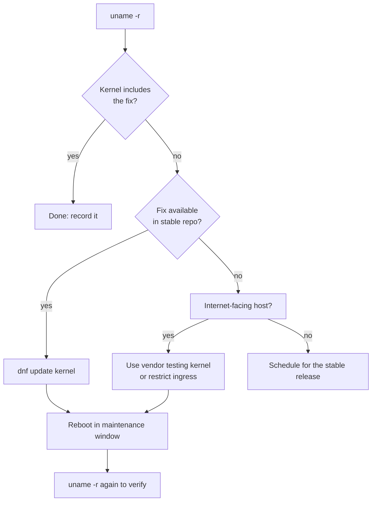
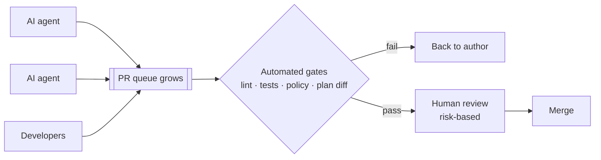
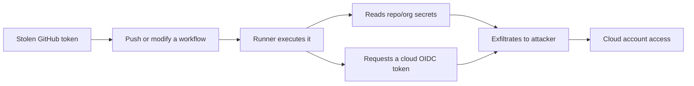

<!--
EDITOR CHECKLIST — remove before publishing (this comment is not rendered).
Add a source link to every item. In particular, need a primary source for:
  * CVE-2026-98432 (CVSS 9.8, IPv4 TCP use-after-free) and AlmaLinux's
    testing kernels; confirm the exact repo/package names before publishing
    the commands.
  * Linux 7.3 "upcoming": last week's digest said Ubuntu 26.10 already ships
    7.3. One of the two is wrong.
  * Branch Target Reuse (BTR), the "Gheist" campaign, the OpenCode breach,
    Amazon "Tokenmaxxing" warnings, Chainguard's agent platform, Foundry
    updates, Figma "Specs".
  * AWS DevOps Agent release-management preview, "always-on AWS DevOps
    engineer", EKS Container Network Observability, CodeBuild macOS Fastlane.
-->


*A week to patch, then rotate. A critical kernel bug in TCP connection setup, a credential-stealing campaign running through GitHub Actions, and a leak of AI API keys all point the same way: check what is exposed and what can reach your secrets. Then a look at where AI agents are moving the bottleneck in DevOps work.*

**In this issue**

1. **Cloud & DevOps**: AWS DevOps Agent, EKS network observability
2. **Linux & server management**: CVE-2026-98432, Spectre "BTR", AppArmor
3. **Career & learning**: the PR review wall, agent kill-switch playbooks
4. **Tech news & strategy**: Tokenmaxxing, the Gheist campaign, the OpenCode breach
5. **AI/automation in DevOps**: Chainguard, Foundry, Figma Specs

---

## 1. Cloud & DevOps

- **AWS DevOps Agent: release management (preview).** The agent can now run release tests on its own and review code changes before they ship.
- **An always-on "AWS DevOps engineer" service** looks across operational history for patterns, finds root causes and suggests changes so incidents don't repeat.
- **Amazon EKS Container Network Observability** shows service-to-service traffic inside the cluster, which makes "is it DNS, the network policy or the app?" much faster to answer.
- **AWS CodeBuild for macOS** now comes with **Fastlane** pre-installed, so iOS code signing and test lanes run without bootstrapping the toolchain in every build.

---

## 2. Linux & server management

### CVE-2026-98432: use-after-free in IPv4 TCP connection setup (CVSS 9.8)

A **critical use-after-free** was disclosed in the code that handles **incoming IPv4 TCP connections**. Any host that accepts TCP connections is in scope: web servers, SSH bastions, load balancer backends. Treat it as an emergency patch.

**AlmaLinux** published patched kernels for **AlmaLinux 8, 9 and 10** in its testing repositories, ahead of the upstream RHEL update.



Follow the chart from the top: if the fixed kernel is already in your stable repo, update and reboot. If not, decide by exposure. Internet-facing hosts either take the vendor's testing kernel or get their inbound access narrowed until the stable fix lands.

```bash
uname -r                             # running kernel
sudo dnf check-update kernel         # is a newer kernel available?
sudo dnf update kernel
sudo needs-restarting -r             # dnf-utils: does the host need a reboot?
# after the reboot
uname -r
```

### Spectre v2 returns: Branch Target Reuse (BTR)

A new **Spectre v2** variant, **Branch Target Reuse**, targets **just-in-time compilers** (JavaScript engines, the JVM, eBPF). Check what your CPUs and kernel report, and keep microcode and kernel updates together.

```bash
grep . /sys/devices/system/cpu/vulnerabilities/spectre_v2
```

### AppArmor in Linux 7.3: compressed policies

The **Linux 7.3** merge window brought AppArmor support for **compressed security policies loaded from user space**, which makes large policy sets for container hosts cheaper to load.

---

## 3. Career & learning

### The bottleneck moved from writing code to reviewing it

With AI coding agents, the slowest step in many teams is no longer writing infrastructure code. It is **reviewing it**. More PRs arrive than people can read carefully, and anything merged without a real review becomes quality debt.



The fix is to stop asking people to read everything. Let automated gates (linters, tests, policy-as-code, `terraform plan` diffs) reject the obvious failures, and save human attention for risky changes: IAM, networking, data.

### Playbooks for stopping an AI agent mid-incident

Teams also need a written way to **stop an agent quickly** when it is doing something unsafe, particularly inside Kubernetes. The minimum playbook covers three things: stop it, cut its permissions, cut its network.

```bash
# 1. Stop it
kubectl -n agents scale deployment/ops-agent --replicas=0

# 2. Cut its permissions
kubectl -n agents get rolebinding,clusterrolebinding -o wide | grep ops-agent
kubectl -n agents delete rolebinding ops-agent-rw

# 3. Cut its network: deny all egress from the agent's pods
kubectl -n agents apply -f - <<'EOF'
apiVersion: networking.k8s.io/v1
kind: NetworkPolicy
metadata:
  name: ops-agent-quarantine
spec:
  podSelector:
    matchLabels:
      app: ops-agent
  policyTypes: [Egress]
EOF
```

Then rotate every credential the agent could read, because stopping the pod does not take back what it already saw.

---

## 4. Tech news & strategy

### Amazon warns engineers about "Tokenmaxxing"

Amazon reportedly warned its engineers internally about **"Tokenmaxxing"**: burning generative-AI tokens far beyond what a task needs. If one of the biggest cloud providers is rationing its own usage, expect token budgets to become a normal line in your team's cost reviews.

### The Gheist campaign: GitHub tokens → Actions → cloud credentials

Researchers are tracking **Gheist**, a campaign that uses **stolen GitHub tokens** to add or change **Actions workflows**, which then pull **cloud credentials and repository secrets** out of private environments.



Break the chain at each step:

| Step | Control |
| --- | --- |
| Stolen token | Fine-grained tokens with expiry; SSO-enforced; revoke unused |
| Workflow changes | Branch protection + required review on `.github/workflows/**` (CODEOWNERS) |
| Runner reads secrets | Default `permissions: read-all` or less; secrets scoped to environments with reviewers |
| Cloud OIDC token | Trust policy pinned to repo **and** branch/environment, not `repo:org/*` |
| Third-party actions | Pin to a full commit SHA, not a tag |

```yaml
# .github/workflows/deploy.yml: least-privilege defaults
permissions:
  contents: read
  id-token: write   # only in the job that deploys
jobs:
  deploy:
    environment: production   # requires approval, holds the secrets
    steps:
      - uses: actions/checkout@<full-commit-sha>
```

```bash
# Audit what Actions may do in a repository
gh api repos/OWNER/REPO/actions/permissions
gh api repos/OWNER/REPO/actions/permissions/workflow
```

### The OpenCode breach exposed AI provider API keys

The **OpenCode** breach exposed API keys for **Anthropic, Google and OpenAI**, a reminder that model-distillation pipelines and AI tooling collect high-value credentials. If any of your keys passed through affected tooling, **rotate them now** and set spend limits on the new keys.

---

## 5. AI/automation in DevOps

- **Chainguard** launched a security-first platform for **hosting and running autonomous AI agents**: hardened images and controls for what agents are allowed to do.
- **Microsoft Foundry** updates bring agent operations closer to **CI/CD practice**, with automated routines, trace-based insights and lower token costs.
- **Figma "Specs"** adds code layers and more **Model Context Protocol (MCP)** tools, so AI agents can read designs as structured data.

---

*Patch, rotate, then review. See the [full archive](/newsletter) for earlier issues.*
