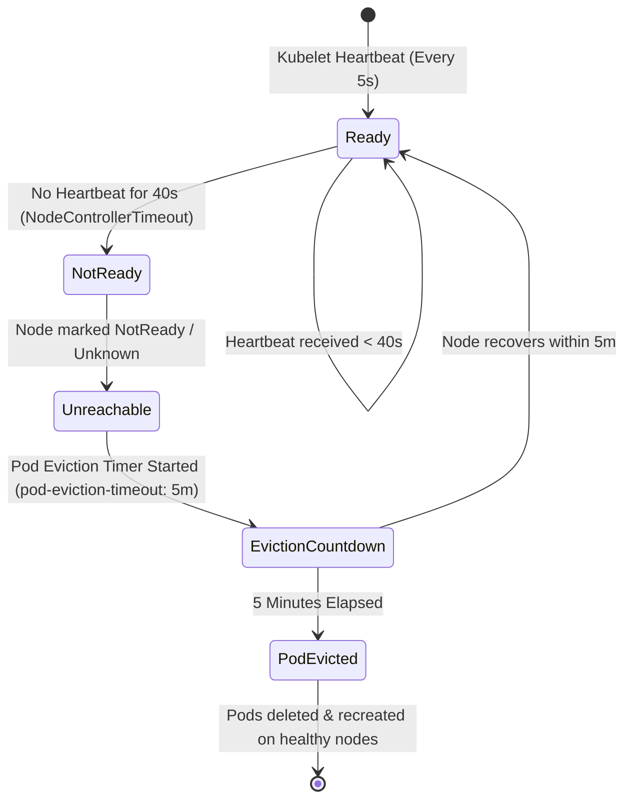

# Kubernetes ETCD Architecture: v2 vs v3 APIs, PKI Snapshots, and Node Eviction Timelines

In a Kubernetes cluster, **ETCD** is the single source of truth. Every pod spec, namespace, secret, deployment, and node status is stored as a key-value record inside this distributed, consistent datastore. 

When control planes degrade or disaster strikes, understanding how ETCD operates under the hood — and how controllers react to failure states — is what separates successful cluster recoveries from catastrophic data loss.

---

## 1. The ETCDCTL API v2 vs v3 Paradigm

`etcdctl` is the command-line utility used to communicate with ETCD. A frequent source of confusion during administration and CKA exams is the difference between **API version 2** and **API version 3**.

```bash
# Check or configure API version in your shell
export ETCDCTL_API=3
```

> [!IMPORTANT]
> If `ETCDCTL_API` is not set, `etcdctl` defaults to **Version 2**. In API v2, modern commands like `snapshot save` and `endpoint health` will fail with command not found errors!

### Command Differences:
| API Version 2 (Legacy) | API Version 3 (Modern Kubernetes) | Purpose |
| :--- | :--- | :--- |
| `etcdctl backup` | `etcdctl snapshot save <file>` | Snapshot database state |
| `etcdctl cluster-health` | `etcdctl endpoint health` | Cluster quorum check |
| `etcdctl set /key value` | `etcdctl put /key value` | Write key-value pair |
| `etcdctl get /key` | `etcdctl get /key` | Read key |

---

## 2. Authenticating with ETCD mTLS Certificates

ETCD runs with mutual TLS (mTLS). To query it directly with `etcdctl`, you must provide the Certificate Authority (`ca.crt`), client certificate (`server.crt`), and private key (`server.key`):

```bash
# Standard PKI location on kubeadm control-plane nodes
--cacert /etc/kubernetes/pki/etcd/ca.crt
--cert   /etc/kubernetes/pki/etcd/server.crt
--key    /etc/kubernetes/pki/etcd/server.key
```

### Inspecting Keys Inside the Control Plane
```bash
kubectl exec -n kube-system etcd-controlplane -- sh -c \
  "ETCDCTL_API=3 etcdctl get / \
   --prefix --keys-only --limit=10 \
   --cacert=/etc/kubernetes/pki/etcd/ca.crt \
   --cert=/etc/kubernetes/pki/etcd/server.crt \
   --key=/etc/kubernetes/pki/etcd/server.key"
```

### Creating and Restoring a Cluster Snapshot
```bash
# Save snapshot
sudo ETCDCTL_API=3 etcdctl snapshot save /var/lib/etcd-snapshot.db \
  --cacert=/etc/kubernetes/pki/etcd/ca.crt \
  --cert=/etc/kubernetes/pki/etcd/server.crt \
  --key=/etc/kubernetes/pki/etcd/server.key

# Verify snapshot integrity
sudo ETCDCTL_API=3 etcdctl snapshot status /var/lib/etcd-snapshot.db --write-out=table
```

---

## 3. Controller Manager & The Node Failure Lifecycle

All Kubernetes controllers run packaged inside the `kube-controller-manager`. One of the most critical controllers is the **Node Controller**, which watches node health and orchestrates pod rescheduling during infrastructure outages.



### The Three Critical Node Timeouts:
1. **Heartbeat Frequency (`nodeStatusUpdateFrequency: 5s`)**: The Kubelet on each worker node reports its health to `kube-apiserver` every 5 seconds.
2. **Node Monitor Grace Period (`node-monitor-grace-period: 40s`)**: If the API server does not hear from a node for 40 seconds, the Node Controller marks the node status as `NotReady` or `Unknown`.
3. **Pod Eviction Timeout (`pod-eviction-timeout: 5m`)**: After a node is marked `Unknown`, Kubernetes gives the host a **5-minute grace period** to recover before forcibly evicting pods and rescheduling them onto surviving cluster nodes.

---

## 4. Control Plane Core Summary

- **`kube-apiserver`**: The front-door for all cluster requests. Authenticates users, validates admission webhooks, updates ETCD, and mediates controller communication.
- **`kube-scheduler`**: Watches for newly created pods with no assigned node and selects the optimal node based on resource requests, taints, and affinity rules.
- **`kube-proxy`**: Runs on each worker node as a virtual network router, synchronizing iptables or IPVS rules to forward service traffic to pod backends.
- **`kubelet`**: The node agent ensuring containers described in PodSpecs are running and healthy.
