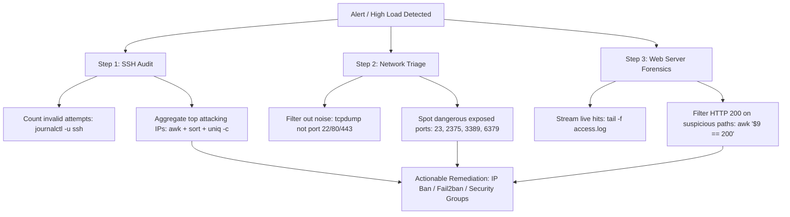

# Linux Incident Forensics: Investigating SSH Brute-Force, Unauthorized Traffic & Web RCE

When an alert triggers or an Internet-facing server experiences high CPU and network saturation, system administrators cannot afford guesswork. You need a systematic, repeatable forensic procedure to extract attacker IPs, inspect packet flows, and identify web shell executions.

Here is the operational playbook for rapid triage using native Linux command-line utilities.



---

## 1. Investigating SSH Brute-Force Attacks

Public servers are continuously scanned by botnets cycling through credential dictionaries. Here is how to analyze the attack scale and isolate the attackers:

### Count Total Failed Login Attempts
```bash
# Count total failed login events
sudo journalctl -u ssh | grep -c "Invalid user"
```
> The `-c` flag instructs `grep` to output only the line count, giving you immediate visibility into the attack volume.

### Extract and Rank Top Attacking IP Addresses
To see which IP addresses are repeatedly hitting your server:

```bash
sudo journalctl -u ssh | grep "Invalid user" | awk '{print $8}' | sort | uniq -c | sort -rn | head -n 20
```

**Command Breakdown:**
- `awk '{print $8}'` — Extracts the 8th whitespace-separated column (the attacking IP address).
- `sort` — Groups identical IP strings together for counting.
- `uniq -c` — Counts occurrences of each unique IP address.
- `sort -rn` — Numerically sorts the counts in reverse order (highest attack count at the top).
- `head -n 20` — Displays the top 20 most aggressive IP addresses.

### Count Total Distinct Attacking IPs
```bash
sudo journalctl -u ssh | grep "Invalid user" | awk '{print $10}' | sort -u | wc -l
```

### Audit Targeted Usernames
Attackers frequently target default or high-privilege usernames:

```bash
# Count attempts targeting a specific username (e.g. root, ubuntu, deploy)
sudo journalctl -u ssh | grep -c "authenticating user root"
```

### Verify Successful Logins
Crucially, always verify whether any attacker successfully breached the perimeter:

```bash
sudo journalctl -u ssh | grep "Accepted"
```
> [!WARNING]
> If any accepted login line contains an unrecognized IP address or unusual timestamp, immediately assume potential compromise, isolate the host, and inspect active sessions with `w` and `last`.

---

## 2. Network Traffic Inspection with TCPDump

When an unknown process or connection is active, `tcpdump` helps capture anomalous ingress/egress while filtering out expected management traffic.

### Filter Out Standard Traffic (SSH, HTTP, HTTPS)
```bash
sudo tcpdump -n -i eth0 not port 22 and not port 80 and not port 443
```

- `-n` — Prevents DNS resolution (faster and avoids generating additional DNS packets).
- `-i eth0` — Binds to the primary network interface (e.g., `eth0`, `ens5`).
- `not port 22 and not port 80 and not port 443` — Silences management and standard web traffic, instantly exposing suspicious ports.

### Dangerous Exposed Ports to Watch Out For:

| Port | Service | Risk Profile |
| :--- | :--- | :--- |
| **23** | Telnet | Unencrypted plaintext credentials; target for IoT malware (Mirai). |
| **3389** | RDP | Windows Remote Desktop; frequent brute-force and BlueKeep exploits. |
| **6379** | Redis | Defaults to unauthenticated access; attackers exploit it to overwrite `authorized_keys`. |
| **2375** | Docker Engine API | Unencrypted daemon socket; allows unauthenticated root container escapes. |

---

## 3. Web Server Forensics (Nginx Access Logs)

Attackers use automated scanners searching for vulnerable PHP scripts, `.env` files, git configurations, and remote code execution endpoints.

### Real-Time Ingress Monitoring
```bash
sudo tail -f /var/log/nginx/access.log
```

### Identify Exploits that Succeeded (HTTP 200 OK)
Attackers scan hundreds of endpoints that return `404 Not Found`. What matters forensically is identifying requests that returned **HTTP 200 OK**:

```bash
# In standard Nginx logs, the HTTP status code is the 9th column:
sudo awk '$9 == 200' /var/log/nginx/access.log* | grep -E "(\.env|\.git|php|cmd|exec|sh)"
```

### Top 10 Requested URI Paths
```bash
sudo awk '{print $7}' /var/log/nginx/access.log | sort | uniq -c | sort -rn | head -n 10
```

---

## 4. Remediation Checklist

1. **Disable SSH Password Authentication**:
   In `/etc/ssh/sshd_config`:
   ```text
   PasswordAuthentication no
   PubkeyAuthentication yes
   PermitRootLogin prohibit-password
   ```
2. **Deploy Fail2ban**:
   Automatically ban IPs exceeding 5 failed SSH authentication attempts within 10 minutes.
3. **Bind Sensitive Services to Localhost**:
   Ensure Redis (`127.0.0.1:6379`) and Docker sockets are never exposed to `0.0.0.0`.
4. **Enforce Security Groups & Firewalld**:
   Drop all unsolicited ingress packets at the cloud network layer before they touch the host kernel.
