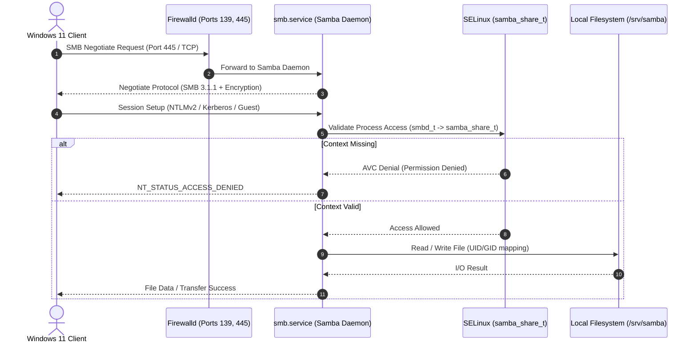

# Samba Server and Windows Client Configuration in RHEL 10

When sharing files across a hybrid infrastructure, **Samba** remains the industry-standard bridge connecting Linux filesystems with Windows clients over the **SMB (Server Message Block)** protocol. 

While legacy implementations used SMB 1.0 (CIFS), **RHEL 10 ships with Samba 4.x**, featuring modern SMB 2.1, SMB 3.0 encrypted shares, Active Directory domain interoperability, and tight integration with Linux DAC and SELinux.



---

## 1. Prerequisites and Host Preparation

Set a valid static hostname on your RHEL 10 server. The hostname must resolve cleanly via DNS or local hosts files for Windows NetBIOS / CIFS resolution:

```bash
# Set static hostname
sudo hostnamectl set-hostname rhel10-storage.internal

# Verify hostname settings
hostnamectl
```

Install the core Samba server, client utilities, and common libraries:

```bash
sudo dnf install -y samba samba-client samba-common
```

Verify your Windows client's active workgroup name (by default, `WORKGROUP`):

```cmd
:: Run on Windows PowerShell / Command Prompt
net config workstation
```

Backup the default `/etc/samba/smb.conf` before making modifications:

```bash
sudo cp /etc/samba/smb.conf /etc/samba/smb.conf.orig
```

---

## 2. Deploying an Anonymous (Public) Read-Only Share

An anonymous share allows anyone on the local network to browse and read shared documentation without typing credentials.

### Step 2.1: Create Directory and Set DAC Permissions

```bash
sudo mkdir -p /srv/samba/anonymous
sudo chmod -R 0755 /srv/samba/anonymous
sudo chown -R nobody:nobody /srv/samba/anonymous
```

### Step 2.2: Apply Persistent SELinux File Context

> [!IMPORTANT]
> Never use temporary `chcon` commands in production! Any filesystem relabel or `restorecon` execution will wipe out the context. Always define persistent policy rules with `semanage fcontext`.

```bash
# 1. Add permanent SELinux context rule for the share
sudo semanage fcontext -a -t samba_share_t "/srv/samba/anonymous(/.*)?"

# 2. Relabel directory to apply the persistent rule
sudo restorecon -Rv /srv/samba/anonymous

# 3. Verify the applied label
ls -Zd /srv/samba/anonymous
# Expected output: unconfined_u:object_r:samba_share_t:s0
```

### Step 2.3: Configure `/etc/samba/smb.conf`

Edit `/etc/samba/smb.conf`:

```ini
[global]
    workgroup = WORKGROUP
    server string = RHEL 10 Samba Server %v
    netbios name = RHEL10-STORAGE
    security = user
    map to guest = Bad User
    dns proxy = no

[anonymous]
    path = /srv/samba/anonymous
    browseable = yes
    writable = no
    guest ok = yes
    read only = yes
```

---

## 3. Deploying an Authenticated (Secured) Share

For department shares or confidential assets, access must be restricted to authenticated group members.

### Step 3.1: Linux User and Group Creation

Samba uses its own password database (`passdb`), but every Samba user **must correspond to an underlying Linux account**:

```bash
# 1. Create dedicated group and user (without shell login for security)
sudo groupadd securedgroup
sudo useradd -M -s /sbin/nologin -G securedgroup engineer1

# 2. Assign Samba password for the user
sudo smbpasswd -a engineer1
# (Enter and confirm the Samba password)

# 3. Enable the user in Samba passdb
sudo smbpasswd -e engineer1
```

### Step 3.2: Storage Directory and SELinux

```bash
# Create secured storage directory
sudo mkdir -p /srv/samba/secured
sudo chown -R root:securedgroup /srv/samba/secured
sudo chmod -R 0770 /srv/samba/secured

# Apply permanent SELinux context
sudo semanage fcontext -a -t samba_share_t "/srv/samba/secured(/.*)?"
sudo restorecon -Rv /srv/samba/secured
```

### Step 3.3: Append Share Definition to `smb.conf`

```ini
[secured]
    comment = Internal Engineering Secured Share
    path = /srv/samba/secured
    valid users = @securedgroup
    guest ok = no
    writable = yes
    browseable = yes
    create mask = 0660
    directory mask = 0770
```

---

## 4. Syntax Validation, Firewall & Service Activation

### Step 4.1: Test Configuration Syntax

Always run `testparm` before reloading the daemon to catch syntax errors or invalid parameters:

```bash
testparm -s
```

```text
Load smb config files from /etc/samba/smb.conf
Loaded services file OK.
Server role: ROLE_STANDALONE
```

### Step 4.2: Open Firewall Ports

Samba requires both `smb` (file transfer on TCP 139 and 445) and `nmb` (NetBIOS name service on UDP 137):

```bash
# Allow Samba service in firewalld
sudo firewall-cmd --permanent --add-service=samba
sudo firewall-cmd --reload

# Verify active services
sudo firewall-cmd --list-services
```

### Step 4.3: Start and Enable Daemons

```bash
sudo systemctl enable --now smb.service nmb.service

# Check daemon health
sudo systemctl status smb.service --no-pager
```

---

## 5. Connecting from Clients & Verification

### From Linux Client:
```bash
# Discover available shares
smbclient -L //192.168.1.50 -N

# Connect with credentials
smbclient //192.168.1.50/secured -U engineer1
```

### From Windows Client:
1. Open Windows File Explorer (`Win + E`).
2. In the address bar, type:
   ```text
   \\192.168.1.50\anonymous
   ```
3. To map the secured share with credentials:
   ```cmd
   net use Z: \\192.168.1.50\secured /user:engineer1 *
   ```

---

## 6. Production Troubleshooting Matrix

| Symptom | Root Cause | Solution |
| :--- | :--- | :--- |
| **Windows error 0x80070043** | Port 445/139 blocked by firewalld | Run `firewall-cmd --permanent --add-service=samba && firewall-cmd --reload` |
| **Permission Denied (NT_STATUS_ACCESS_DENIED)** | SELinux context mismatch (`default_t` instead of `samba_share_t`) | Check with `ls -Zd <path>`; fix with `semanage fcontext -a -t samba_share_t "path(/.*)?" && restorecon -Rv <path>` |
| **Password prompt keeps failing** | User not added to Samba database | Run `sudo smbpasswd -a <user>` |
| **User can browse but cannot write** | `writable = yes` missing or Linux group permissions don't allow write (`0770`) | Check both Linux `chmod` and Samba `writable = yes` in `smb.conf` |
