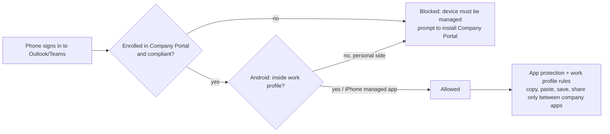

# The Mobile Access Runbook: Company Portal, Work Profile and the Copy-Paste Block

**Tenant:** `contoso.com` · **Tenant ID:** `00000000-0000-0000-0000-000000000000` · **Pilot user:** Maya Chen (`maya.chen@contoso.com`) · **Last updated:** 27 Oct 2026

**Goal:** Microsoft 365 works on Android and iPhone **only** after the phone is set up in Company Portal (Android: work profile). Company data **cannot** be copied out of the Office apps or the work profile into personal apps.

> **Sanitization note:** every identifier in this post is fictional. The tenant is `contoso.com`, the tenant ID is a zeroed placeholder GUID, the pilot user is "Maya Chen", and all device IDs are placeholders. If you adapt this runbook, replace every one of them with your own values.

Do the steps in order. Assign everything to the **pilot group** only. Every Conditional Access policy starts in **Report-only**.

---

## What blocks what

| Need | Done by | Step |
|---|---|---|
| Force Company Portal and the work profile | Enrollment restrictions + Conditional Access "Require compliant device" | 2, 9 |
| Block personal-side Android apps | Conditional Access filter on work-profile OS | 10 |
| Health check (PIN, OS, not rooted) | Compliance policies | 7 |
| Block copy from work profile to personal side (Android) | Work profile device restrictions | 3 |
| Block copy out of Office apps (Android and iOS) | App protection policies | 8 |
| Block opening company files in personal apps (iOS) | iOS device restrictions | 4 |

---

## Step 1. Preparation (one time)

1. **Pilot group.** Entra > *Groups > New group* > Security > `MDM-Pilot-Users` > add **Maya** only.
2. **Break-glass account.** Make sure the cloud-only emergency Global Admin exists. It is excluded from every Conditional Access policy below.
3. **Unassigned devices count as non-compliant.** Intune > *Devices > Compliance > Compliance policy settings* > **Mark devices with no compliance policy assigned as: Not compliant** > Save.
4. **Android: Managed Google Play.** Intune > *Devices > Android > Android enrollment > Managed Google Play* > I agree > Launch Google to connect now. Sign in with an IT-owned Google account (not a personal one). Status must show **Setup**.
5. **iOS: Apple MDM Push certificate.** Intune > *Devices > iOS/iPadOS > iOS/iPadOS enrollment > Apple MDM Push certificate*:
   1. Download the CSR.
   2. Create the certificate at Apple's push certificates portal with an **IT-owned Apple ID**. Write down which Apple ID you used.
   3. Upload the `.pem` file and enter the Apple ID.
   4. Add a calendar reminder: the certificate expires after **one year** and must be renewed with the **same Apple ID**.

---

## Step 2. Enrollment restrictions

Intune > *Devices > Enrollment > Device platform restrictions*

**Android**
1. Android tab > **Create restriction**. Name: `contoso - Android - Work profile only`.
2. *Android Enterprise (work profile)*: **Allow**. Personally owned: **Allow**.
3. *Android device administrator*: **Block**.
4. Assign to `MDM-Pilot-Users` > Create.

**iOS**
1. iOS/iPadOS tab > **Create restriction**. Name: `contoso - iOS - Allow enrollment`.
2. Platform: **Allow**. Personally owned: **Allow** (set **Block** if only company iPhones may enroll).
3. Assign to `MDM-Pilot-Users` > Create.

**Device limit:** *Device limit restrictions* > Create > limit **3** per user > assign to the group.

> Later, when all users are in scope, also edit the **Default** platform restriction so device administrator is blocked for everyone.

---

## Step 3. Android: block copy between work and personal profile

Intune > *Devices > Android > Configuration > Create > New policy*
- Platform: **Android Enterprise**
- Profile type: **Templates > Device restrictions** under *Personally-Owned Work Profile*
- Name: `contoso - Android - Work profile data separation`

*Work profile settings:*

| Setting | Value |
|---|---|
| Copy and paste between work and personal profiles | **Block** |
| Data sharing between work and personal profiles | **Prevent any sharing across boundaries** |
| Work profile notifications while device locked | Block |
| Screen capture | **Block** |
| Display work contact caller-id in personal profile | Allow (optional: lets calls show names) |
| Search work contacts from personal profile | Block |
| Contact sharing via Bluetooth | Block |
| Add and remove accounts | **Block** (stops adding Gmail in the work profile) |

*Password / Work profile password:* require a work-profile PIN (6 digits minimum), or rely on the device PIN in the compliance policy.

Assign to `MDM-Pilot-Users` > Create.

---

## Step 4. iOS: block company files opening in personal apps

Intune > *Devices > iOS/iPadOS > Configuration > Create > New policy* > **Templates > Device restrictions**
Name: `contoso - iOS - Managed data`

*App Store, Doc Viewing, Gaming:*

| Setting | Value |
|---|---|
| Viewing corporate documents in unmanaged apps | **Block** |
| Allow unmanaged apps to read from managed contacts accounts | Block |
| Viewing non-corporate documents in corporate apps | Block |
| Treat AirDrop as an unmanaged destination | **Yes** |
| Allow copy/paste to be affected by managed open-in | **Yes** |

Assign to `MDM-Pilot-Users` > Create.

> These settings only apply to apps Intune installed as **managed** (Step 5). Apps the user installed themselves are unmanaged.

---

## Step 5. Required apps

**Android** (*Apps > Android > Add > Managed Google Play app*): approve and add **Microsoft Outlook, Microsoft Teams, Microsoft OneDrive, Microsoft Edge, Microsoft Word, Excel, PowerPoint**, and **Microsoft Authenticator**. Assign each as **Required** to `MDM-Pilot-Users`. They install into the work profile automatically.

**iOS** (*Apps > iOS/iPadOS > Add > iOS store app*): add the same apps plus **Microsoft Authenticator** (required on iPhone: it passes the device identity to Outlook and Teams). Assign as **Required** to `MDM-Pilot-Users`.

> If the user already installed Outlook from the App Store, Intune asks the user to let it take over management. Tell them to tap **Manage** when prompted.

---

## Step 6. iOS: single sign-on extension (needed for Safari/Edge)

Intune > *Devices > iOS/iPadOS > Configuration > Create > Templates > Device features*
- Name: `contoso - iOS - Enterprise SSO`
- *Single sign-on app extension* > SSO app extension type: **Microsoft Entra ID**
- Assign to `MDM-Pilot-Users` > Create.

Without it, the browser on an enrolled iPhone sends no device identity and is blocked.

---

## Step 7. Compliance policies

Intune > *Devices > Compliance > Create policy*

**Android:** Platform **Android Enterprise** > Profile **Personally-owned work profile**. Name `contoso - Android - Compliance`.

| Section | Setting | Value |
|---|---|---|
| Device Health | Rooted devices | Block |
| Device Health | Play Integrity verdict | Check basic integrity & device integrity |
| Device Health | Require the device to be at or under the Device Threat Level | Not configured (unless you use Defender) |
| Device Properties | Minimum OS version | 12.0 (adjust to your phones) |
| System Security | Require a password to unlock | Require, Numeric complex, minimum length 6 |
| System Security | Encryption of data storage | Require |
| System Security | Block apps from unknown sources | Block |
| Actions for noncompliance | Mark device noncompliant | **Immediately** while piloting (1 day later in production) |

**iOS:** Platform **iOS/iPadOS**. Name `contoso - iOS - Compliance`.

| Section | Setting | Value |
|---|---|---|
| Device Health | Jailbroken devices | Block |
| Device Properties | Minimum OS version | 17.0 (adjust) |
| System Security | Require a password | Require, minimum 6 digits, simple passwords blocked |
| System Security | Maximum minutes after screen lock before password is required | Immediately |
| Actions for noncompliance | Mark device noncompliant | Immediately while piloting |

Assign both to `MDM-Pilot-Users`.

---

## Step 8. App protection policies (copy-paste block inside Office apps)

Intune > *Apps > Protection > Create policy*. Make one for **Android** and one for **iOS/iPadOS** with the same values.

**Apps:** Target **all app types** > Selected public apps: Outlook, Teams, OneDrive, Edge, Word, Excel, PowerPoint, SharePoint, Microsoft 365 (Office).

**Data protection:**

| Setting | Value |
|---|---|
| Backup org data to Android backup services / iTunes and iCloud backups | Block |
| Send org data to other apps | **Policy managed apps** |
| Save copies of org data | **Block**; allow saving to **OneDrive for Business** and **SharePoint** |
| Transfer telecommunication data to | Any dialer app |
| Receive data from other apps | Policy managed apps |
| Open data into Org documents | Block; allow OneDrive for Business, SharePoint |
| Restrict cut, copy, and paste between other apps | **Policy managed apps with paste in** |
| Cut and copy character limit for any app | 0 |
| Screen capture and Google Assistant (Android) | Block |
| Third-party keyboards (iOS) | Block |
| Org data notifications | Block org data |
| Restrict web content transfer with other apps | Microsoft Edge |
| Printing org data | Block (or Allow if users need to print) |

"Policy managed apps with paste in" means: text can be pasted **into** Outlook from anywhere, but text copied **from** Outlook can only be pasted into other company apps.

**Access requirements:**

| Setting | Value |
|---|---|
| PIN for access | Require, numeric, 6 digits |
| Biometrics instead of PIN | Allow |
| Recheck access requirements after (minutes of inactivity) | 30 |

**Conditional launch:**

| Condition | Value | Action |
|---|---|---|
| Offline grace period | 720 min | Block access |
| Offline grace period | 90 days | Wipe data |
| Jailbroken/rooted devices | — | Block access |
| Disabled account | — | Block access |

Assign to `MDM-Pilot-Users` > Create.

---

## Step 9. Conditional Access policy 1: require a managed phone

Entra > *Protection > Conditional Access > Policies > New policy*
Name: `contoso - Mobile - Require compliant device`

| Field | Value |
|---|---|
| Users > Include | Select groups > `MDM-Pilot-Users` |
| Users > Exclude | Break-glass account; Directory roles > **Global Administrator** |
| Target resources > Include | All resources |
| Target resources > Exclude | **Microsoft Intune Enrollment**, **Microsoft Intune** |
| Conditions > Device platforms | Configure Yes > Include **Android**, **iOS** |
| Conditions > Client apps | Not configured |
| Grant | Grant access > **Require device to be marked as compliant** |
| Enable policy | **Report-only** |

> Do **not** forget the Intune exclusions. Without them, an unenrolled phone cannot enroll, because Company Portal itself gets blocked.

---

## Step 10. Conditional Access policy 2: Android work profile only

This blocks personal-side Android apps and phones enrolled the old way, even during a compliance grace period.

Name: `contoso - Android - Block outside work profile`

| Field | Value |
|---|---|
| Users | Same as Step 9 (include group, exclude break-glass and Global Administrator) |
| Target resources | All resources, exclude Microsoft Intune Enrollment and Microsoft Intune |
| Device platforms | Include **Android** only |
| Filter for devices | Configure Yes > **Exclude filtered devices from policy** |
| Rule syntax | `device.operatingSystem -eq "AndroidForWork" -or device.operatingSystem -eq "AndroidEnterprise"` |
| Grant | **Block access** |
| Enable policy | **Report-only** |

---

## Step 11. Check the pilot user's existing per-user rule

Her rule `contoso - Maya-Chen - Blocked Other Devices` still applies, and a sign-in must pass **every** policy.

- Her **Pixel 8** (`<entra-device-id>`) is already in her rule, so it passes.
- Any **new** phone she enrolls stays blocked by her rule until its Entra Device ID is added.

Choose one:
- **Keep IT approval per phone:** leave her rule as is and add new phone IDs (see the per-device section of the internal mobile runbook).
- **Let compliance decide on phones:** edit her rule > *Device platforms* > Include **Windows** and **macOS** only. Phones are then governed by Steps 9–10.

While editing, also add **Microsoft Intune Enrollment** and **Microsoft Intune** to her rule's excluded resources and add the break-glass exclusion. The exported policy has neither.

---

## Step 12. Enroll the pilot phone (with the user)

**Android**
1. Play Store > install **Intune Company Portal** > sign in with `maya.chen@contoso.com`.
2. Tap **Begin** > accept > the phone creates the **work profile**. Set the work PIN if asked.
3. Wait for the work apps (briefcase icon). Open **work** Outlook and sign in.
4. Company Portal > *Devices* > this phone > **Check status** > **Compliant**.

**iPhone**
1. App Store > install **Intune Company Portal** and **Microsoft Authenticator**.
2. Company Portal > sign in > **Begin** > **Download profile**.
3. *Settings > Profile Downloaded > Install*. Then *Settings > General > VPN & Device Management* to confirm it is installed.
4. Back in Company Portal > finish > wait for **Compliant**. Accept the prompts to let Intune manage Outlook and Teams.
5. Authenticator > add the work account.

---

## Step 13. Test in Report-only

Entra > *Monitoring > Sign-in logs* > filter User = Maya > open each entry > **Report-only** tab.

| Test | Policy 1 (compliant) | Policy 2 (Android work profile) |
|---|---|---|
| Android: Outlook in **work profile** | Report-only: Success | Report-only: Not applied |
| Android: Outlook on **personal side** | Report-only: Failure | Report-only: Failure |
| Android: phone without Company Portal | Report-only: Failure | Report-only: Failure |
| iPhone: managed Outlook/Teams | Report-only: Success | Not applied |
| iPhone: Safari or Edge after Step 6 | Report-only: Success | Not applied |
| iPhone not enrolled | Report-only: Failure | Not applied |
| Company Portal enrollment on a new phone | Not applied (Intune excluded) | Not applied |
| Global Admin signing in on a phone | Not applied | Not applied |

**Copy-paste tests** (these work as soon as Steps 3, 4 and 8 reach the phone, even with Conditional Access still in Report-only):

| Test | Expected |
|---|---|
| Copy text in work Outlook > paste into personal WhatsApp | Blank paste or "Your organization's data cannot be pasted here" |
| Copy text in work Outlook > paste into work Teams | Works |
| Copy from a website > paste into work Outlook | Works ("with paste in") |
| Outlook attachment > Save to phone storage / Files | Refused; OneDrive/SharePoint offered |
| Outlook attachment > Share > WhatsApp or Gmail | Personal apps not offered or refused |
| Screenshot inside work Outlook (Android) | Blocked |
| iPhone: AirDrop a work file | Refused |

---

## Step 14. Switch On and roll out

1. When every row in Step 13 is right, open each policy > *Enable policy:* **On** > Save.
2. Revoke Maya's sessions so old phone sign-ins stop: Entra > *Users* > Maya > **Revoke sessions**.
3. Retest one allowed and one blocked case.
4. Roll out: add users to `MDM-Pilot-Users` **one at a time**, ask them to do Step 12, check their sign-in logs.
5. When everyone is in, you can change Steps 9–10 from the group to **All users** (keep the break-glass and Global Administrator exclusions) and assign the Intune policies to *All users*.

**Rollback:** set the Conditional Access policy to **Off** (takes effect within minutes). App protection policies can be unassigned without touching access.

---

## Step 15. Troubleshooting

| Symptom | Cause | Fix |
|---|---|---|
| Company Portal stops with "You can't get there from here" | Intune not excluded in a Conditional Access policy (or in the per-user rule) | Exclude Microsoft Intune Enrollment and Microsoft Intune |
| No work profile option on Android | Managed Google Play not set up, or device administrator still allowed | Step 1.4, Step 2 |
| Enrolled phone shows **Not compliant** | PIN, OS version, Play Integrity | Fix on phone; Company Portal > Check status |
| Enrolled, compliant phone still blocked | Maya's per-user rule (ID not listed) | Step 11 |
| iPhone Outlook blocked although enrolled | Authenticator missing / Outlook not managed | Install Authenticator; accept "Manage" prompt |
| iPhone Safari blocked | SSO extension profile not applied | Step 6; sync in Company Portal |
| Copy-paste still works from Outlook to WhatsApp | App protection policy not applied yet, or Outlook not signed in with work account | Outlook > Settings shows a briefcase/"managed by your organization"; wait up to 30 min, reopen the app |
| Copy-paste still works between work and personal profile (Android) | Step 3 profile not assigned or not synced | Company Portal > Settings > Sync |
| Users can't print from Outlook | "Printing org data" blocked | Change to Allow if needed |
| All iPhones stop checking in | Apple MDM Push certificate expired | Renew with the same Apple ID |

---

## The one-paragraph version

Enroll first (Company Portal / work profile), then gate access on compliance with Conditional Access in Report-only, then lock the data itself with app protection and work-profile restrictions so copy, paste, save and share only ever move between company apps. Test everything while the policies only *report*, flip them **On** once every row passes, and roll out one user at a time. Every name, ID and device in this post is a placeholder — swap in your own tenant, pilot user and device IDs before you touch production.
